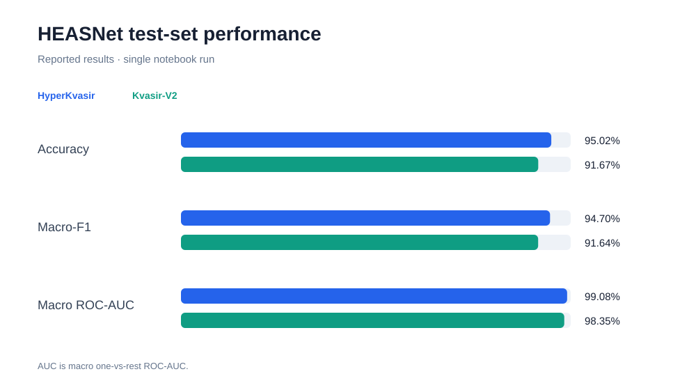
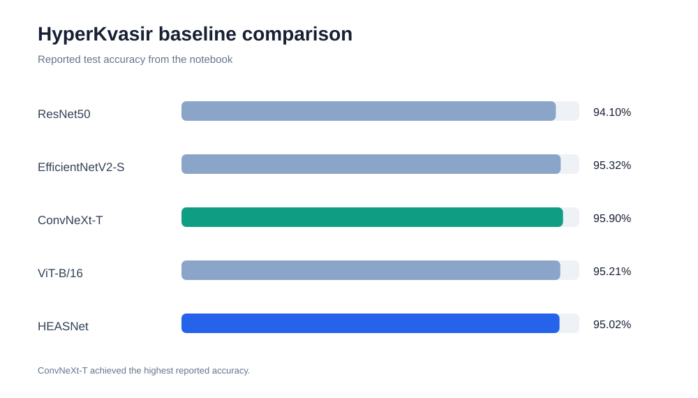
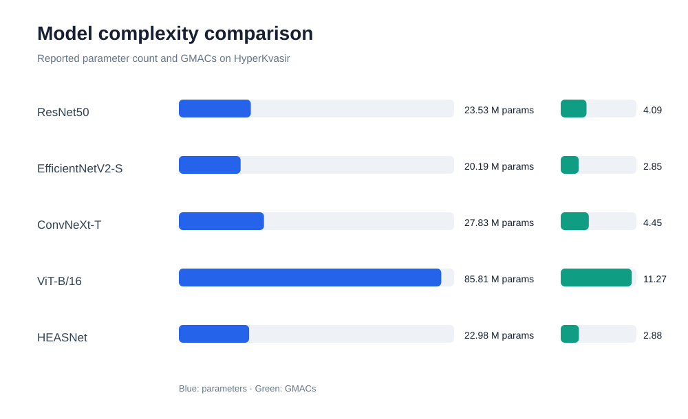

# HEASNet: Hybrid EfficientNetV2–Attention Network

Research implementation for gastrointestinal image classification using an EfficientNetV2-S backbone with squeeze-and-excitation (SE), window attention and axial attention.

The original notebook has been separated into ordered Python components while preserving its sequential shared-global execution flow. Results below are transcribed from the supplied completed notebook and represent **single runs**, not multi-seed averages.

## Reported test results

| Dataset | Classes | Test images | Accuracy | Macro precision | Macro recall | Macro-F1 | Macro ROC-AUC | Cohen's κ | MCC |
|---|---:|---:|---:|---:|---:|---:|---:|---:|---:|
| HyperKvasir | 12 | 2,609 | **95.02%** | 94.68% | 94.77% | 94.70% | 99.08% | 0.9454 | 0.9454 |
| Kvasir-V2 | 8 | 1,200 | **91.67%** | 91.89% | 91.67% | 91.64% | 98.35% | 0.9048 | 0.9052 |

HyperKvasir accuracy 95% bootstrap CI: 94.21–95.82%; best validation accuracy 95.00% at epoch 35. Kvasir-V2 accuracy 95% bootstrap CI: 90.16–93.17%; best validation accuracy 92.17% at epoch 38.

See [reported_metrics.json](results/tables/reported_metrics.json) and [cross_dataset_summary.csv](results/tables/cross_dataset_summary.csv).

## Architecture

EfficientNetV2-S feature extractor → 1×1 projection → SE channel recalibration → window attention → axial attention → pooling and classification head. Input size: 224×224; embedding dimension: 512.

Reported HEASNet complexity: **22.98 M parameters** and **2.88 GMACs** (approximately 5.76 GFLOPs).

## Results figures







## HyperKvasir baseline comparison

| Model | Parameters (M) | GMACs | Test accuracy | Test macro-F1 |
|---|---:|---:|---:|---:|
| ResNet50 | 23.53 | 4.0872 | 94.10% | 93.90% |
| EfficientNetV2-S | 20.19 | 2.8486 | 95.32% | 95.08% |
| ConvNeXt-T | 27.83 | 4.4548 | **95.90%** | **95.72%** |
| ViT-B/16 | 85.81 | 11.2704 | 95.21% | 94.89% |
| HEASNet | 22.98 | 2.8808 | 95.02% | 94.70% |

ConvNeXt-T achieved the highest reported baseline accuracy. HEASNet is competitive and substantially smaller than ViT-B/16, but it does **not** outperform every baseline. Detailed tables: [baseline CSV](results/tables/hyperkvasir_baseline_comparison.csv) and [ablation CSV](results/tables/hyperkvasir_ablation.csv).

## Experimental configuration

| Setting | Value |
|---|---:|
| Input size / batch size | 224 × 224 / 16 |
| Epochs | 40 (5 frozen-backbone warm-up + 35 fine-tuning) |
| Optimizer | AdamW |
| Head / backbone learning rate | 1e-4 / 1e-5 |
| Weight decay / label smoothing | 1e-5 / 0.05 |
| Dropout / seed | 0.30 / 42 |
| Validation / test fraction | 15% / 15% |
| Bootstrap repetitions | 1,000 |

## Repository structure

```text
HsNet/
├── heasnet/                 # 16 ordered experiment components
├── notebooks/               # lightweight notebook entry point
├── results/
│   ├── figures/summary/     # README SVG figures
│   └── tables/              # CSV and JSON metrics
├── run_experiment.py
├── requirements.txt
├── PROJECT_MANIFEST.json
└── README.md
```

## Setup and execution

```bash
git clone https://github.com/Visheshtanwar/HsNet.git
cd HsNet
pip install -r requirements.txt
python run_experiment.py
```

Install a PyTorch/torchvision build compatible with your GPU and CUDA version. The default dataset roots are configured in `heasnet/00_runtime_config.py`:

- HyperKvasir: `/kaggle/input/datasets/visheshtanwar26/processed-datatset`
- Kvasir-V2: `/kaggle/input/datasets/subhajeetdas/kvasir-v2-gastrointestinal-image-dataset/KVASIR V2`

Datasets are not redistributed here. Update `DATASETS` for your own environment. Optional ablations and baseline reruns can be computationally expensive.

## Important data-integrity caveat

The notebook's near-duplicate audit reported test-to-training near-duplicate matches of **13.49%** for HyperKvasir and **16.58%** for Kvasir-V2. Its cross-dataset audit reported **12.92%** overlap between Kvasir-V2 test images and HyperKvasir images. These overlaps may inflate performance estimates; interpret results cautiously. A stricter follow-up should deduplicate source images before splitting and use an independent external test set.

## Reproducibility notes

- Results are from the saved notebook run; GPU nondeterminism and software versions may cause small differences.
- Baseline and proposed-model results are single-run values; repeated-seed mean ± standard deviation is not provided.
- The modular components are syntax-checked but the GitHub package has not been end-to-end rerun against the original datasets and GPU environment.
- The downloadable project archive created with the notebook organization contains 50 exported notebook PNG figures; GitHub contains the compact SVG summary figures shown above.

## Citation

Please cite the associated paper/preprint once available. No complete bibliographic record was provided in the notebook, so publication details are not fabricated.
